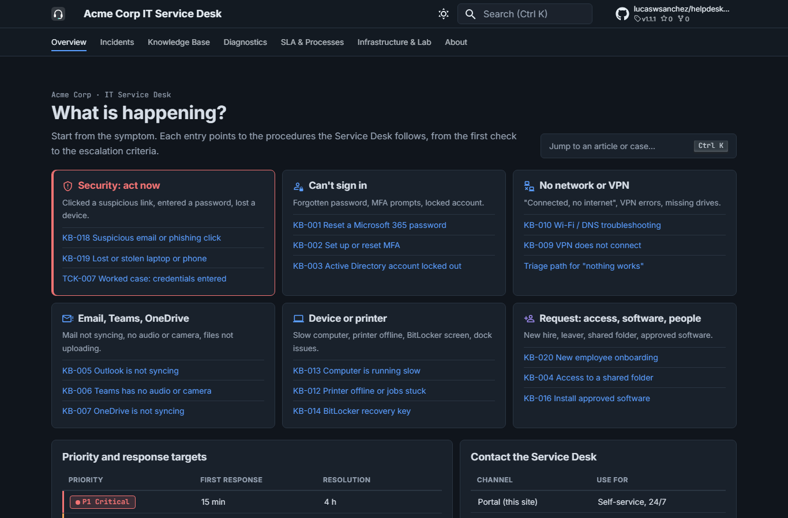
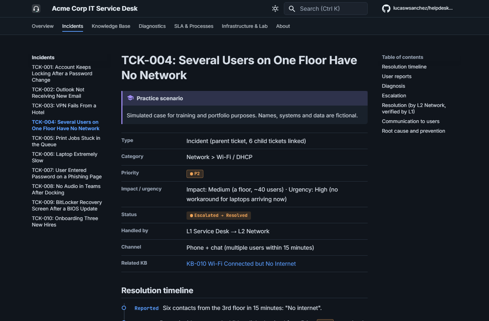
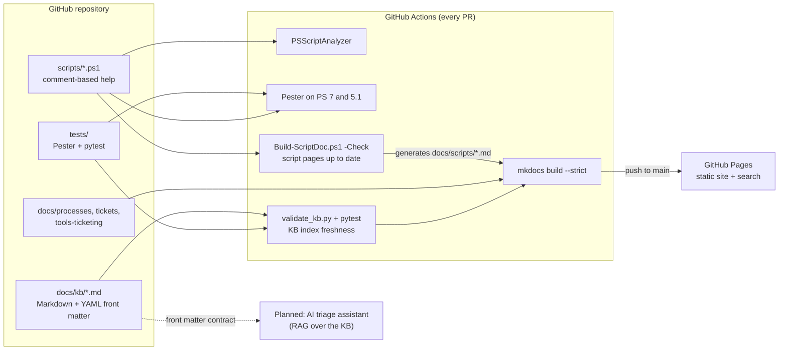

# Acme Corp IT Service Desk — Knowledge Base & PowerShell Toolkit

**A self-service IT support portal with 21 troubleshooting articles, ITIL 4 processes, 10 worked ticket cases and 7 tested PowerShell scripts, built the way a real Service Desk documents its work.**

[](https://github.com/lucaswsanchez/helpdesk-kb/actions/workflows/ci.yml)
[](https://github.com/lucaswsanchez/helpdesk-kb/actions/workflows/deploy.yml)
[](LICENSE)


## 🔗 [**Live site → lucaswsanchez.github.io/helpdesk-kb**](https://lucaswsanchez.github.io/helpdesk-kb/)

&nbsp;&nbsp;&nbsp;[Knowledge Base](https://lucaswsanchez.github.io/helpdesk-kb/kb/) · [Priority matrix & SLAs](https://lucaswsanchez.github.io/helpdesk-kb/processes/priority-matrix/) · [Ticket cases](https://lucaswsanchez.github.io/helpdesk-kb/tickets/) · [PowerShell toolkit](https://lucaswsanchez.github.io/helpdesk-kb/scripts/) · [Project board](https://github.com/users/lucaswsanchez/projects/3)



<details>
<summary>Incident case with ticket fields and a colored resolution timeline</summary>



</details>

> Acme Corp is a **fictional company**. Ticket cases are clearly marked **practice scenarios**. No real user data is included.

## What this project demonstrates

| Help desk skill | Where to see it |
|---|---|
| **Troubleshooting** with a structured, layered method | [KB articles](https://lucaswsanchez.github.io/helpdesk-kb/kb/) (e.g. [Wi-Fi/DNS with ipconfig, nslookup, tracert](https://lucaswsanchez.github.io/helpdesk-kb/kb/kb-010-wifi-dns-troubleshooting/)) and [ticket cases](https://lucaswsanchez.github.io/helpdesk-kb/tickets/) |
| **Documentation** that is consistent and maintainable | Article template enforced by a validator in CI |
| **Windows, Microsoft 365, Active Directory** | Password/MFA, Outlook, Teams, OneDrive, lockouts, BitLocker, onboarding/offboarding |
| **Networking basics** | VPN, Wi-Fi/DNS, DHCP exhaustion case, connectivity script |
| **ITIL 4 basics** | Incident vs. request, impact × urgency matrix with SLAs, escalation flow (Mermaid) |
| **Ticketing tools** | How the KB maps to [Zendesk / Freshdesk](https://lucaswsanchez.github.io/helpdesk-kb/tools-ticketing/) (fields, SLA policies, macros, views) |
| **Customer communication in English and Spanish** | [Response templates](https://lucaswsanchez.github.io/helpdesk-kb/processes/response-templates/) and the user message in every ticket case |
| **Automation & scripting** | 7 PowerShell scripts with `-WhatIf`, help, error handling and Pester tests |
| **Security awareness** | Phishing containment, identity verification before resets, secure handling of recovery keys and passwords |

## Features

- **Operations-workspace UI** on MkDocs Material: a symptom-first overview ("What is happening?" triage grid, security first), ticket-style incident pages (fields, *Handled by*, colored resolution timeline), client-side filters for incidents and KB articles, a **Ctrl+K command palette** over the real search index (pages and section headings), real captured script output, and an [infrastructure dependency map](https://lucaswsanchez.github.io/helpdesk-kb/infrastructure/). Dark-first [design system](https://lucaswsanchez.github.io/helpdesk-kb/design-system/) (#10151C / #19212B / #5B9EFF / #42C8B5 / #F2A65A, Inter + JetBrains Mono). No simulated monitoring or fake telemetry.
- **Knowledge base, 21 articles** in 7 categories, each with *Summary, Applies to, Symptoms, Cause, Resolution, Escalation criteria, Related articles, Last reviewed*, a support level (**L1/L2**) and an estimated resolution time shown as badges.
- **ITIL 4 processes**: incident vs. service request, priority matrix and SLA targets, tiered escalation flow, onboarding/offboarding checklists, bilingual response templates.
- **10 ticket case studies** (practice scenarios) showing classification, step-by-step diagnosis, escalation notes and user communication.
- **PowerShell toolkit** (`scripts/`):

  | Script | Purpose |
  |---|---|
  | `Get-SystemDiagnostics.ps1` | OS, uptime, CPU, RAM, disks, network → HTML report with health warnings |
  | `Test-Connectivity.ps1` | Gateway → internet → DNS → TCP port checks, CSV export |
  | `Clear-TempFiles.ps1` | Safe temp cleanup with `-WhatIf`, skips files in use, reports space freed |
  | `Export-InstalledSoftware.ps1` | Installed software inventory to CSV |
  | `New-BulkADUser.ps1` | Bulk AD users from CSV with `-WhatIf` and automatic simulation mode |
  | `Get-InactiveAccount.ps1` | Accounts inactive for 90+ days, from AD or CSV |
  | `Reset-PrintSpooler.ps1` | Clear stuck print jobs and restart the spooler |

- **RAG-ready content**: articles are clean Markdown with validated YAML front matter (`id`, `title`, `category`, `level`, `tags`, …) in `docs/kb/`.

## Tech Stack

| Area | Tools |
|---|---|
| Documentation site | MkDocs 1.6, Material for MkDocs 9.7, Mermaid, Python-Markdown extensions |
| Scripting | PowerShell (Windows PowerShell 5.1 and PowerShell 7), CIM, .NET networking APIs |
| Testing & quality | Pester 5+, PSScriptAnalyzer, pytest, `mkdocs build --strict`, EditorConfig |
| CI/CD | GitHub Actions (`windows-latest` + `ubuntu-latest`), GitHub Pages |
| Project management | GitHub Issues, Milestones, Projects (Kanban), PRs with Conventional Commits |

## Architecture



## Getting Started

### Without Docker (recommended on Windows)

```bash
git clone https://github.com/lucaswsanchez/helpdesk-kb.git
cd helpdesk-kb
python -m venv .venv
.venv\Scripts\activate          # macOS/Linux: source .venv/bin/activate
pip install -r requirements.txt
mkdocs serve                     # http://127.0.0.1:8000/helpdesk-kb/
```

Try the scripts (Windows):

```powershell
cd scripts
Set-ExecutionPolicy -Scope Process -ExecutionPolicy Bypass
.\Test-Connectivity.ps1
.\Get-SystemDiagnostics.ps1 -OutputPath $env:TEMP
.\New-BulkADUser.ps1 -CsvPath .\samples\new-hires.csv -Simulate
.\Get-InactiveAccount.ps1 -InputCsv .\samples\ad-users.csv -ReferenceDate 2026-11-17
```

### With Docker

```bash
docker compose up --build        # http://localhost:8000/helpdesk-kb/
```

The container serves the documentation site only; the PowerShell toolkit targets Windows.

## Environment Variables

None are required: the site is static and the scripts take parameters. See [`.env.example`](.env.example).

| Variable | Default | Used by |
|---|---|---|
| `DOCS_PORT` | `8000` | `docker-compose.yml` host port |

## Running Tests

```powershell
# PowerShell: lint + Pester (needs Pester 5+ and PSScriptAnalyzer)
Install-Module Pester -MinimumVersion 5.5 -Scope CurrentUser -SkipPublisherCheck
Install-Module PSScriptAnalyzer -Scope CurrentUser
./tools/Invoke-CI.ps1

# Script documentation is generated from Get-Help; check it is up to date
./tools/Build-ScriptDoc.ps1 -Check
```

```bash
# Python: KB validator tests, KB validation and strict site build
pytest -q
python tools/validate_kb.py
python tools/gen_kb_index.py --check
mkdocs build --strict
```

Current suite: **114 Pester tests** (run on both Windows PowerShell 5.1 and PowerShell 7; 2 of them need an elevated session and run on the CI runner) and **25 pytest tests**. PSScriptAnalyzer reports zero findings.

## Project Management

- **Board:** [GitHub Project (Kanban: Backlog / In progress / Done)](https://github.com/users/lucaswsanchez/projects/3)
- **Issues:** 11 user stories ("As a … I want … so that …") with acceptance criteria checklists and labels (`feature`, `docs`, `test`, `ci`), grouped in two milestones: **MVP** and **Polish**.
- **Workflow:** one branch per issue → pull request with `Closes #N` → CI must pass → squash merge. Commits follow [Conventional Commits](https://www.conventionalcommits.org/) (`feat:`, `docs:`, `test:`, `ci:`).
- See [closed PRs](https://github.com/lucaswsanchez/helpdesk-kb/pulls?q=is%3Apr+is%3Aclosed) for the history.

## Roadmap

- [ ] Build the [home lab](https://lucaswsanchez.github.io/helpdesk-kb/lab-plan/) (Windows Server AD + Windows 11 client in VirtualBox) and add real screenshots
- [ ] AI triage assistant that suggests KB articles for a new ticket (RAG over `docs/kb/`)
- [ ] Configure the KB and SLAs in a free Freshdesk / Jira Service Management instance
- [ ] macOS and mobile (iOS/Android) articles
- [ ] Package the toolkit as a PowerShell module with code coverage reporting

## Technical Decisions & Lessons Learned

Full ADRs: [Technical decisions](https://lucaswsanchez.github.io/helpdesk-kb/decisions/).

1. **Docs as code.** Markdown in Git + MkDocs Material on GitHub Pages: free hosting, built-in search, and every article change is reviewed in a PR like code.
2. **Front matter as a contract.** A Python validator in CI enforces fields, allowed values and section order, so the KB stays consistent and machine-readable (ready for search and RAG).
3. **Safe-by-default scripts.** Read-only diagnostics; `SupportsShouldProcess` for anything that changes state; automatic simulation mode for AD; passwords only as `SecureString`.
4. **Testing without production.** Pester with `TestDrive`, a loopback TCP listener, a temporary registry key and stubbed AD cmdlets, run on PowerShell 5.1 *and* 7. Lesson learned: Pester evaluates `-Skip` during discovery, so environment checks must live in `BeforeDiscovery`.
5. **Single source of truth for script docs.** Pages are generated from comment-based help and CI fails on drift.
6. **Redesign without new dependencies.** The ops-workspace look, badges, timelines and the Ctrl+K palette (WAI-ARIA combobox) are plain CSS and ~250 lines of vanilla JS on top of Material; overview numbers come from a small MkDocs hook, so nothing is hard-coded or simulated.

## Author

**Lucas Sanchez** — Systems Analyst, Corrientes, Argentina

- LinkedIn: [linkedin.com/in/lucaswsanchez](https://www.linkedin.com/in/lucaswsanchez)
- GitHub: [@lucaswsanchez](https://github.com/lucaswsanchez)
- Portfolio: [lucassanchez.netlify.app](https://lucassanchez.netlify.app)

## License

[MIT](LICENSE)
