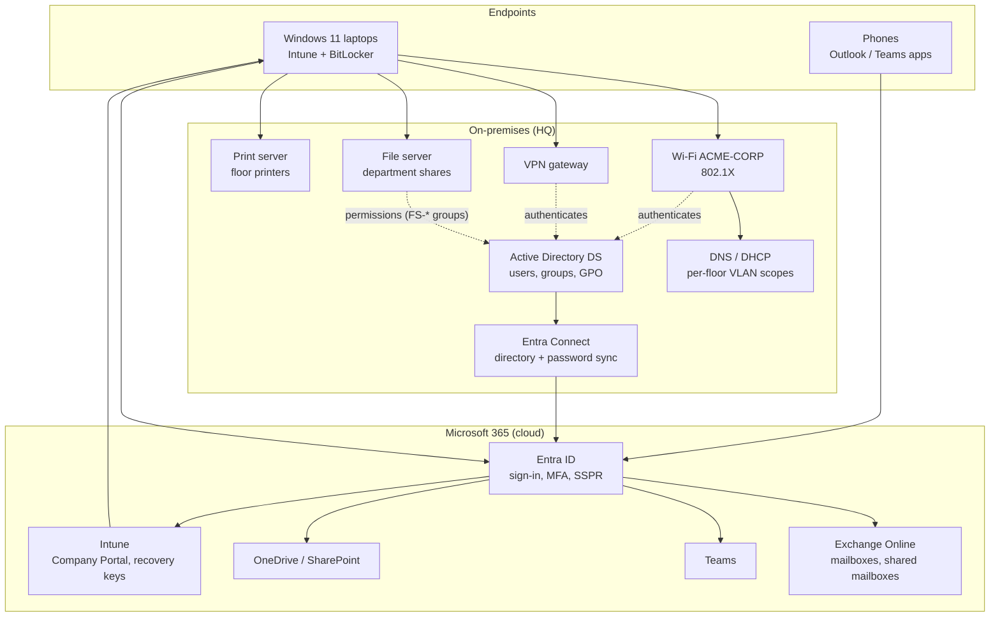
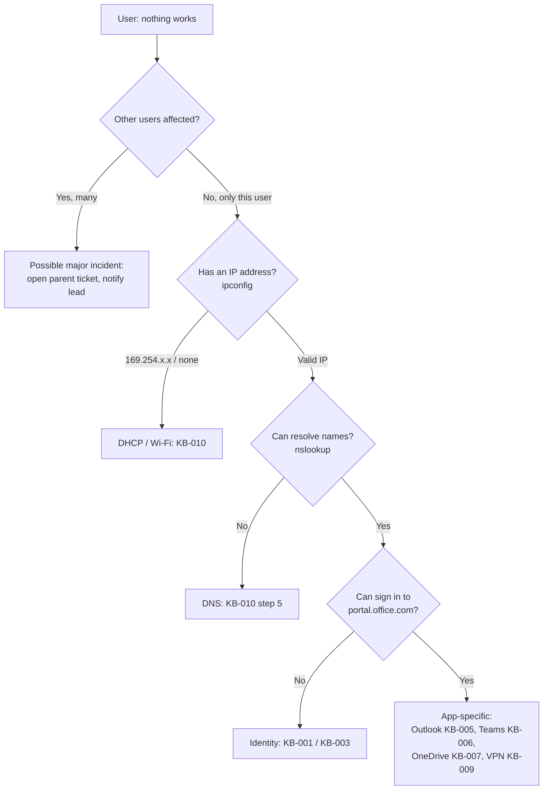

# Infrastructure Map

How the services documented in this knowledge base depend on each other. Use it during triage to answer the most important question for prioritizing an incident: **if this component fails, what else breaks, and for whom?**

!!! note "Documentation, not monitoring"
    This is the reference architecture of the fictional Acme Corp environment as described in the KB articles. It is not connected to any live system and shows no real-time status.

## Service dependency map

## Impact reference

| Component | If it fails, users see | Typical impact | Procedures |
|---|---|---|---|
| **Entra ID / MFA** | Cannot sign in to any Microsoft 365 app, MFA loops | Whole company: P1 | [KB-001](kb/kb-001-reset-m365-password.md), [KB-002](kb/kb-002-mfa-setup-and-reset.md) |
| **Active Directory** | Windows sign-in, Wi-Fi, VPN and file shares fail; lockouts | Site-wide: P1 | [KB-003](kb/kb-003-ad-account-locked-out.md), [KB-004](kb/kb-004-shared-folder-permissions.md) |
| **Entra Connect sync** | New hires or password changes don't reach Microsoft 365 | Delayed changes: P3 | [KB-020](kb/kb-020-employee-onboarding.md) |
| **Exchange Online** | No mail flow, Outlook and OWA both affected | Whole company: P1 | [KB-005](kb/kb-005-outlook-not-syncing.md), [KB-008](kb/kb-008-shared-mailbox-access.md) |
| **DHCP scope (one VLAN)** | "No internet", 169.254.x.x addresses on one floor | One floor: P2 | [KB-010](kb/kb-010-wifi-dns-troubleshooting.md), [TCK-004](tickets/tck-004-floor-no-internet-dhcp.md) |
| **DNS** | Websites and internal names fail, IPs still work | Site-wide: P1 | [KB-010](kb/kb-010-wifi-dns-troubleshooting.md) |
| **VPN gateway** | Remote staff cannot reach shares or internal apps | All remote users: P2 | [KB-009](kb/kb-009-vpn-not-connecting.md), [TCK-003](tickets/tck-003-vpn-hotel-captive-portal.md) |
| **File server** | Mapped drives disconnected, "network path not found" | Department or site: P2 | [KB-011](kb/kb-011-mapped-network-drive.md) |
| **Print server / printer** | Printer offline, jobs stuck | One floor: P4 | [KB-012](kb/kb-012-printer-offline.md), [TCK-005](tickets/tck-005-print-queue-stuck.md) |
| **Intune** | Apps don't install, recovery keys unavailable | Delayed changes: P3 | [KB-014](kb/kb-014-bitlocker-recovery.md), [KB-016](kb/kb-016-install-approved-software.md) |

Impact levels are starting points; apply the [priority matrix](processes/priority-matrix.md) with the real impact and urgency of each incident.

## Triage path for "nothing works"

The [`Test-Connectivity.ps1`](scripts/Test-Connectivity.md) script automates the network half of this path and produces evidence to attach to the ticket.
