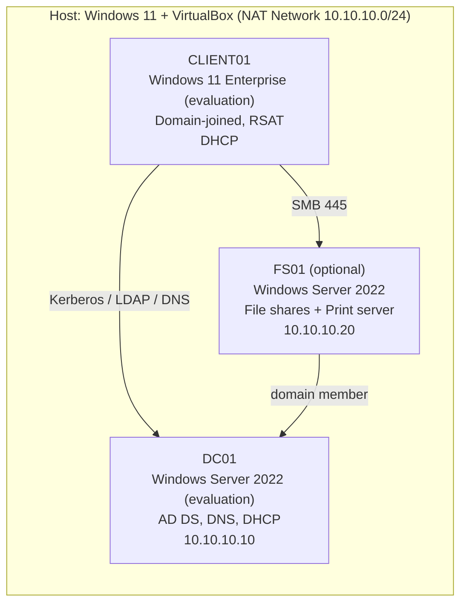

# Home Lab Plan

!!! warning "Status: planned"
    This lab has **not been built yet**. It is the next step to practice the procedures in this KB on real infrastructure instead of documentation and simulation.

## Goal

Build a small Windows domain on a laptop with free tools to practice Active Directory, Group Policy, DNS/DHCP and the toolkit scripts end to end (for example, running `New-BulkADUser.ps1` without `-Simulate`).

## Topology

## Resources

| Item | Choice | Notes |
|---|---|---|
| Hypervisor | VirtualBox | Free; Hyper-V is an alternative on Windows Pro |
| Server OS | Windows Server 2022 evaluation | 180-day evaluation from Microsoft Evaluation Center |
| Client OS | Windows 11 Enterprise evaluation | 90-day evaluation |
| RAM | DC01 2 GB, CLIENT01 4 GB, FS01 2 GB | ~8 GB total; FS01 optional |
| Domain | `lab.acme.example` | Never use a real public domain you don't own |

## Steps

1. Create a VirtualBox **NAT Network** `10.10.10.0/24` with DHCP disabled.
2. Install **DC01**, set a static IP, rename, install **AD DS** and promote to a new forest `lab.acme.example`.
3. Install **DHCP** on DC01, authorize it, create scope `10.10.10.100–200` with DNS option pointing to DC01.
4. Create the OU structure: `Acme > Users`, `Acme > Computers`, `Acme > Groups`, `Disabled Users`.
5. Install **CLIENT01**, join the domain, install **RSAT: Active Directory**.
6. Run the toolkit against the lab:
    - `New-BulkADUser.ps1 -CsvPath .\samples\new-hires.csv -OrganizationalUnit 'OU=Users,OU=Acme,DC=lab,DC=acme,DC=example' -UpnSuffix lab.acme.example`
    - `Get-InactiveAccount.ps1`
7. Practice KB procedures: account lockout and Event 4740 (KB-003), shared folder permissions with `FS-*` groups (KB-004), mapped drives through Group Policy (KB-011), DHCP exhaustion (TCK-004), print spooler (KB-012).
8. Document each exercise as a new ticket case with real screenshots.

## Success criteria

- [ ] Domain, DNS and DHCP working; CLIENT01 joined
- [ ] Bulk user creation from CSV in AD mode with an audit log
- [ ] Group Policy drive mapping and a department share with group-based permissions
- [ ] At least three KB procedures reproduced and documented with screenshots
