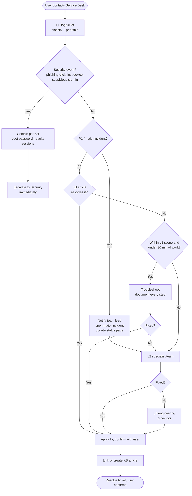

# Escalation Flow

Escalation is not failure. It is how the right person gets the ticket at the right time. There are two types:

- **Functional escalation**: to a team with more expertise or permissions (L1 → L2 → L3 / vendor).
- **Hierarchical escalation**: to management, when an SLA is at risk, a VIP is involved or a decision is needed.

## Support tiers

| Tier | Who | Typical scope |
|---|---|---|
| **L0** | Self-service portal (this site) | KB articles, password reset (SSPR), Company Portal. |
| **L1** | Service Desk analysts | First contact, classification, KB-based fixes, account unlocks, basic M365 and device troubleshooting. Target: resolve ~70% at first contact. |
| **L2** | Desktop, Identity, Messaging, Network specialists | Admin-level fixes, group and permission changes, deeper diagnostics, onboarding/offboarding. |
| **L3** | Infrastructure / Security engineers | Servers, firewall, identity platform, root-cause analysis, security investigations. |
| **Vendor** | Microsoft, printer/hardware vendor, ISP | Product bugs, hardware repairs under warranty, ISP outages. |

## Flow



## When L1 must escalate

- The fix needs permissions L1 does not have (server, Exchange admin, firewall, Intune policies).
- The KB article's **Escalation criteria** section says so.
- 30 minutes of troubleshooting without progress on a P3/P4, or 15 minutes on a P2.
- **SLA at 75%** of the resolution target with no clear fix (hierarchical escalation to the team lead).
- Several users report the same symptom (possible major incident).
- Any **security** event.

## How to escalate well (the hand-off note)

A good escalation saves the next team from repeating your work. Use this structure in the ticket:

```text
Summary:      Outlook desktop not receiving email since 09:10; OWA works.
Impact:       1 user (Finance), workaround via OWA. Priority P4.
Steps tried:  Work offline off; safe mode same; Office updated (build 2410);
              OST rebuilt; new profile created -> same behaviour.
Evidence:     Screenshot of "Disconnected" status, Test-Connectivity report attached.
Ask:          Please check mailbox/connection on Exchange side.
User contact: Available on Teams until 18:00; prefers chat.
```

## Hierarchical escalation

Notify the **team lead** when:

- A P1 is opened (always), or a P2 is at 50% of its resolution time.
- A VIP or executive is affected.
- The user is unhappy with the service and asks to escalate a complaint.
- A vendor is not meeting their contract response time.
