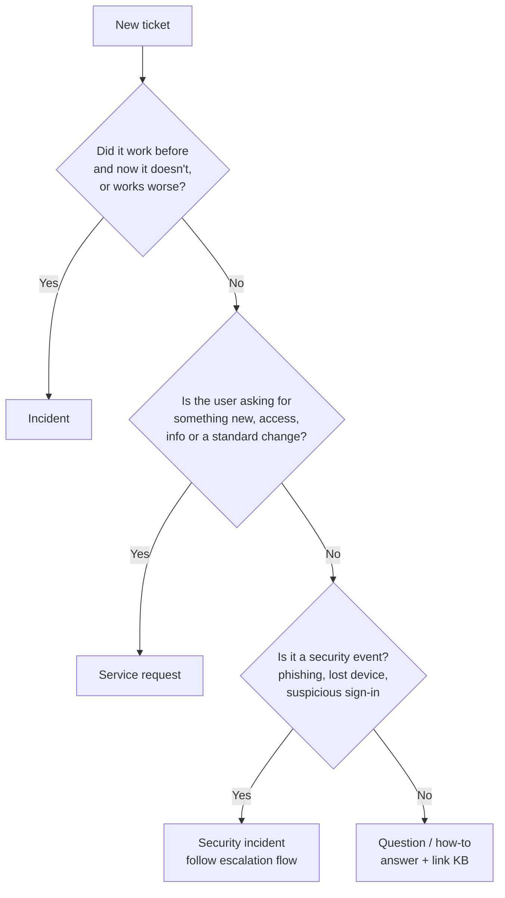

# Incidents vs. Service Requests

The first decision on every ticket is its **type**. It drives the workflow, the SLA and the reports.

| | **Incident** | **Service request** |
|---|---|---|
| **ITIL 4 definition** | An unplanned interruption to a service or a reduction in its quality. | A request from a user for something that is a normal part of service delivery. |
| **In plain words** | "Something that used to work is broken or degraded." | "I need something new, or a standard change." |
| **Goal** | Restore normal service **as fast as possible**. | Fulfill the request **as agreed**, usually with approval. |
| **Measured by** | Priority (impact × urgency) and resolution SLA. | Fulfillment time per catalog item. |
| **Approval** | Not needed to fix. | Often needed (manager, data owner, budget). |
| **Examples** | Outlook not syncing, VPN down, printer offline, laptop very slow, suspected phishing click. | New hire account, access to a shared folder, new software, a second monitor, shared mailbox access. |

## How to classify: three questions

## Related ITIL 4 practices

- **Problem management**: when the same incident keeps happening (for example, 5 VPN tickets in a week from the same office), the Service Desk opens a **problem** record so L2/L3 can find the root cause. Incidents restore service; problems prevent recurrence.
- **Change enablement**: fixes that change infrastructure (firewall rules, Group Policy, server configuration) go through a change request, even during an incident, unless it is an approved emergency change.
- **Knowledge management**: every resolved ticket should be linked to a KB article, or produce one.

## Common misclassifications

| Ticket | Wrong | Right | Why |
|---|---|---|---|
| "I forgot my password" | Incident | **Service request** (standard) | Nothing is broken; it is a routine, pre-approved request. Many teams track it as a request to keep incident metrics clean. |
| "I need access to the Finance folder, I get Access denied" | Incident | **Service request** | The access was never granted; it needs approval. |
| "Everyone on floor 3 lost Wi-Fi" | Service request | **Incident (P1/P2)** | A service is interrupted for many users. |
| "Can you install Spotify?" | Incident | **Service request** (likely rejected) | New software, needs approval against the policy. |
