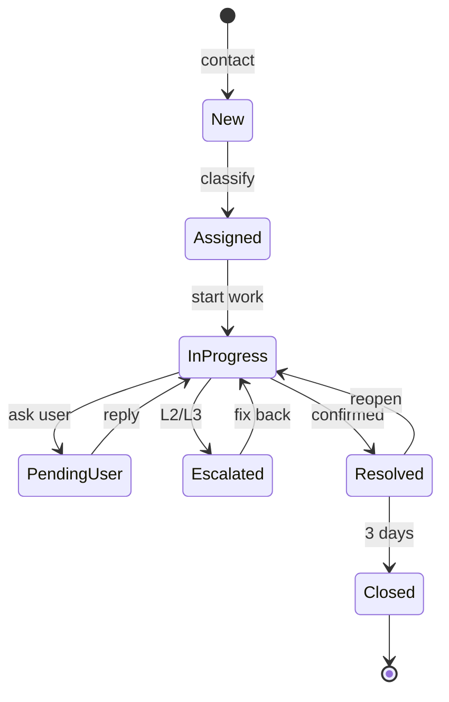

# Service Desk Processes

How the Acme Corp Service Desk receives, classifies, prioritizes, resolves and escalates work. The processes are a lightweight adaptation of **ITIL 4** practices for a small IT team: *Service Desk*, *Incident Management*, *Service Request Management* and *Knowledge Management*.

-   :material-call-split: **Incidents vs. service requests**

    Is something broken, or is the user asking for something? Classify correctly first.

    [Read more &rarr;](incident-vs-request.md)

-   :material-table-large: **Priority matrix & SLAs**

    Impact × urgency gives the priority, and the priority gives the response and resolution targets.

    [Read more &rarr;](priority-matrix.md)

-   :material-sitemap: **Escalation flow**

    When and how a ticket moves from L1 to L2, L3 or a vendor.

    [Read more &rarr;](escalation.md)

-   :material-message-text-outline: **Response templates**

    Ready-to-use replies in English and Spanish with a friendly, clear tone.

    [Read more &rarr;](response-templates.md)

-   :material-account-switch-outline: **Onboarding & offboarding**

    Checklists for joiners and leavers.

    [Read more &rarr;](onboarding-offboarding.md)

## Ticket lifecycle

A ticket moves through these states. *Pending user* pauses the SLA clock; a resolved ticket closes automatically after 3 business days without a reply, or reopens if the user replies.

## Golden rules

1. **Every contact is a ticket.** Phone, chat, email or walk-up, it gets logged, so nothing is lost and we can measure our work.
2. **Search the KB before you troubleshoot.** If an article helped, link it in the ticket. If it was missing or wrong, create or fix it (*Knowledge-Centered Service*).
3. **Verify identity before any account change** (password, MFA, access, recovery keys).
4. **Communicate proactively.** Update the user at least at every SLA checkpoint, even if there is no news.
5. **Write tickets for the next person.** Clear symptoms, steps tried, results and next action.
